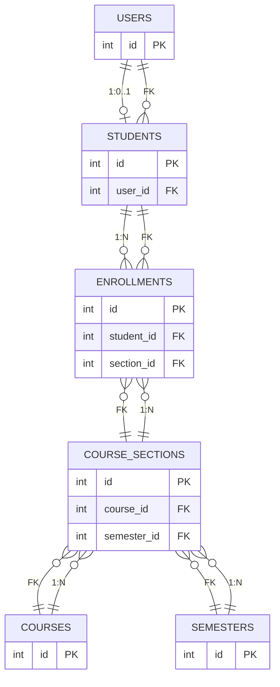

# MiniCampusLMS DB 설계

## 1. 설계 목적

MiniCampusLMS의 학사 기능 구현을 위한 최소 데이터베이스 구조를 정의한다.

현재 프로젝트는 JSP + JDBC + MySQL 구조를 유지하며, 학사 기능은 MVP 범위에 맞게 구현한다.

### 학생
- 강좌 조회
- 수강신청
- 수강취소
- 수강내역 조회

### 관리자
- 강좌 등록
- 강좌 수정
- 강좌 삭제
- 정원 관리
- 수강생 조회

## 2. 설계 원칙

- 기존 users 테이블을 로그인 및 권한 관리에 재사용한다.
- 기존 notice, security_test_log 구조는 보안 실습/공지 기능용으로 유지한다.
- courses는 과목 자체를 의미한다.
- course_sections는 특정 학기와 특정 분반의 개설 강좌를 의미한다.
- students는 users 계정과 1:1 관계로 연결한다.
- 학생은 course_sections를 대상으로 수강신청한다.
- 동일 개설강좌 중복 신청은 서버 검증 + DB UNIQUE 제약으로 함께 보장한다.
- 정원 초과, 시간 충돌, 권한 검사는 서버 측에서도 수행한다.
- 실패 시 일부 데이터만 저장되지 않도록 트랜잭션을 고려한다.
- 향후 동시 수강신청 테스트가 가능하도록 설계한다.
- 필요 이상의 테이블과 복잡한 정규화는 하지 않는다.
- 성적, 등록금, 휴학, 장학금, 교수 기능은 별도로 추가하지 않는다.

## 3. 실제 확인된 기존 테이블

아래는 현재 프로젝트에서 실제로 사용 중인 DB 구조를 MySQL DESCRIBE 결과로 확인한 내용이다.

### users

로그인, 세션, 권한 확인에 사용한다.

| 컬럼 | 자료형 | 제약조건 | 설명 |
|---|---|---|---|
| id | INT | PK, AUTO_INCREMENT | 사용자 식별자 |
| username | VARCHAR(50) | NOT NULL, UNIQUE | 로그인 ID |
| password | VARCHAR(100) | NOT NULL | 비밀번호 |
| name | VARCHAR(50) | NOT NULL | 사용자 이름 |
| role | VARCHAR(20) | NOT NULL, DEFAULT 'STUDENT' | 권한 값. ADMIN / STUDENT |

현재 src/main/webapp/loginAction.jsp에서 `SELECT id, username, name, role FROM users WHERE username = ? AND password = ?` 형태로 사용하고 있다. 따라서 users.id를 세션의 로그인 사용자 식별자로 유지하는 것이 가장 안전하다.

### notice

공지사항 기능에서 사용한다.

| 컬럼 | 자료형 | 제약조건 | 설명 |
|---|---|---|---|
| id | INT | PK, AUTO_INCREMENT | 공지 ID |
| title | VARCHAR(200) | NOT NULL | 제목 |
| content | TEXT | NOT NULL | 내용 |
| writer_id | INT | NOT NULL | 작성자 사용자 ID |
| created_at | TIMESTAMP | DEFAULT CURRENT_TIMESTAMP | 작성 시각 |

현재 구조를 유지한다.

### security_test_log

보안 실습 로그 저장용 테이블이다. 정상 학사 기능과는 별개로 유지한다.

| 컬럼 | 자료형 | 제약조건 | 설명 |
|---|---|---|---|
| id | INT | PK, AUTO_INCREMENT | 로그 ID |
| vuln_type | VARCHAR(50) | NOT NULL | 취약점 종류 |
| target_page | VARCHAR(100) | NOT NULL | 공격 대상 페이지 |
| parameter_name | VARCHAR(50) | NOT NULL | 파라미터 이름 |
| payload | TEXT | NULL 허용 | 공격 페이로드 |
| executed_sql | TEXT | NULL 허용 | 실행된 SQL |
| result_count | INT | DEFAULT 0 | 결과 건수 |
| true_false_result | VARCHAR(20) | NULL 허용 | 참/거짓 결과 |
| memo | VARCHAR(255) | NULL 허용 | 메모 |
| created_at | TIMESTAMP | DEFAULT CURRENT_TIMESTAMP | 로그 생성 시각 |

### courses

기존 테이블로 이미 존재한다. 현재는 과목 기본 정보만 저장한다.

| 컬럼 | 자료형 | 제약조건 | 설명 |
|---|---|---|---|
| id | INT | PK, AUTO_INCREMENT | 과목 ID |
| course_name | VARCHAR(100) | NOT NULL | 과목명 |
| professor | VARCHAR(50) | NOT NULL | 현재 임시 저장 값. 향후 교수 기능 확장 시 분리 가능 |

### enrollments

기존 테이블로 이미 존재한다. 현재는 학생이 과목을 신청한 사실만 저장한다.

| 컬럼 | 자료형 | 제약조건 | 설명 |
|---|---|---|---|
| id | INT | PK, AUTO_INCREMENT | 신청 ID |
| user_id | INT | NOT NULL | 신청한 사용자 ID |
| course_id | INT | NOT NULL | 신청한 과목 ID |
| created_at | TIMESTAMP | DEFAULT CURRENT_TIMESTAMP | 신청 시각 |

## 4. 추가로 필요한 최소 테이블

### students

목적: users 계정과 학생 학사 정보를 연결한다.

| 컬럼 | 자료형 | 제약조건 | 설명 |
|---|---|---|---|
| id | INT | PK, AUTO_INCREMENT | 학생 식별자 |
| user_id | INT | NOT NULL, UNIQUE | users.id FK |
| student_number | VARCHAR(20) | NOT NULL, UNIQUE | 학번 |
| admission_year | SMALLINT | NOT NULL | 입학 연도 |
| status | ENUM('ACTIVE','LEAVE','GRADUATED','DROP') | NOT NULL, DEFAULT 'ACTIVE' | 학생 상태 |
| created_at | TIMESTAMP | NOT NULL, DEFAULT CURRENT_TIMESTAMP | 생성 시각 |

필요 이유:
- users는 계정이며, students는 학생 학사 정보이다.
- 학생용 정보와 관리자/계정 정보가 분리되어야 한다.
- 현재 세션의 loginUserId를 그대로 사용하면서, 학생 상세 정보를 이 테이블에서 연결한다.

### courses

목적: 과목 마스터 정보를 관리한다.

| 컬럼 | 자료형 | 제약조건 | 설명 |
|---|---|---|---|
| id | INT | PK, AUTO_INCREMENT | 과목 ID |
| course_code | VARCHAR(20) | NOT NULL, UNIQUE | 과목 코드 |
| course_name | VARCHAR(100) | NOT NULL | 과목명 |
| description | TEXT | NULL | 과목 설명 |
| created_at | TIMESTAMP | NOT NULL, DEFAULT CURRENT_TIMESTAMP | 등록 시각 |

필요 이유:
- 같은 과목이 여러 학기, 여러 분반으로 개설될 수 있으므로 과목 자체와 개설 정보를 분리한다.
- 현재 기존 courses 테이블의 기본 구조를 유지하면서 필요한 최소 컬럼만 추가한다.

### semesters

목적: 학기 단위를 관리한다.

| 컬럼 | 자료형 | 제약조건 | 설명 |
|---|---|---|---|
| id | INT | PK, AUTO_INCREMENT | 학기 ID |
| year | SMALLINT | NOT NULL | 연도 |
| term | ENUM('1','2','SUMMER','WINTER') | NOT NULL | 학기 구분 |
| start_date | DATE | NULL | 시작일 |
| end_date | DATE | NULL | 종료일 |
| created_at | TIMESTAMP | NOT NULL, DEFAULT CURRENT_TIMESTAMP | 등록 시각 |

UNIQUE: (year, term)

필요 이유:
- 강좌 개설은 학기 단위로 관리되어야 한다.
- 2026년 1학기, 2026년 2학기를 구분하여 수강신청과 조회를 정확하게 수행한다.
- 학기 단위로 조회/통계를 할 수 있는 기본 구조를 제공한다.

### course_sections

목적: 특정 학기에 실제 개설된 강좌 정보를 관리한다.

| 컬럼 | 자료형 | 제약조건 | 설명 |
|---|---|---|---|
| id | INT | PK, AUTO_INCREMENT | 개설강좌 ID |
| course_id | INT | NOT NULL | courses.id FK |
| semester_id | INT | NOT NULL | semesters.id FK |
| section_no | INT | NOT NULL | 분반 번호 |
| professor_name | VARCHAR(50) | NOT NULL | 강의 담당 교수명 |
| day_of_week | ENUM('MON','TUE','WED','THU','FRI','SAT','SUN') | NOT NULL | 강의 요일 |
| start_time | TIME | NOT NULL | 강의 시작 시간 |
| end_time | TIME | NOT NULL | 강의 종료 시간 |
| room_name | VARCHAR(50) | NULL | 강의실 |
| capacity | INT | NOT NULL | 강좌 정원 |
| status | ENUM('OPEN','CLOSED','CANCELLED') | NOT NULL, DEFAULT 'OPEN' | 개설 상태 |
| created_at | TIMESTAMP | NOT NULL, DEFAULT CURRENT_TIMESTAMP | 생성 시각 |

UNIQUE: (course_id, semester_id, section_no)

필요 이유:
- 동일 과목이 동일 학기에 여러 분반으로 개설될 수 있다.
- 정원, 시간, 요일, 교수 정보를 개설강좌 기준으로 관리해야 한다.
- 수강신청은 이 개설강좌를 기준으로 처리해야 한다.

### enrollments

목적: 학생의 수강신청 내역을 관리한다.

| 컬럼 | 자료형 | 제약조건 | 설명 |
|---|---|---|---|
| id | INT | PK, AUTO_INCREMENT | 수강신청 ID |
| student_id | INT | NOT NULL | students.id FK |
| section_id | INT | NOT NULL | course_sections.id FK |
| status | ENUM('ENROLLED','CANCELED') | NOT NULL, DEFAULT 'ENROLLED' | 신청 상태 |
| enrolled_at | TIMESTAMP | NOT NULL, DEFAULT CURRENT_TIMESTAMP | 신청 시각 |
| canceled_at | TIMESTAMP | NULL | 취소 시각 |

UNIQUE: (student_id, section_id)

필요 이유:
- 학생이 동일 개설강좌를 중복 신청하는 것을 DB 차원에서 막아야 한다.
- 신청 취소를 상태값으로 관리하여 전체 이력 추적이 가능하게 한다.
- 수강 내역 조회는 현재 상태가 ENROLLED인 데이터만 기준으로 계산한다.

## 5. 테이블 간 관계

### 학사 핵심 ERD

> notice와 security_test_log는 별도 보안/공지 영역으로 유지하므로, 학사 핵심 ERD에서는 제외한다.

### 관계 설명

- users 1:0..1 students
- students 1:N enrollments
- courses 1:N course_sections
- semesters 1:N course_sections
- course_sections 1:N enrollments

### 관계 구조

- users 1:0..1 students
  - 하나의 user는 학생 계정인 경우에만 최대 하나의 students 레코드를 가질 수 있다.
  - 모든 user가 학생인 것은 아니므로, 학생이 아닌 계정은 students 레코드를 가질 수 없다.
- students 1:N enrollments
  - 학생은 여러 개설강좌를 신청할 수 있다.
- course_sections 1:N enrollments
  - 하나의 개설강좌에는 여러 학생이 신청할 수 있다.
- courses 1:N course_sections
  - 하나의 과목은 여러 학기/분반으로 개설될 수 있다.
- semesters 1:N course_sections
  - 하나의 학기에 여러 개설강좌가 존재할 수 있다.

### 외래키
- students.user_id → users.id
- enrollments.student_id → students.id
- enrollments.section_id → course_sections.id
- course_sections.course_id → courses.id
- course_sections.semester_id → semesters.id

### 기본 관계도

users
  └─ students
      └─ enrollments
           └─ course_sections
               ├─ courses
               └─ semesters

## 6. 제약조건 및 인덱스

### PK
- users.id
- notice.id
- security_test_log.id
- courses.id
- students.id
- semesters.id
- course_sections.id
- enrollments.id

### FK
- students.user_id → users.id
- enrollments.student_id → students.id
- enrollments.section_id → course_sections.id
- course_sections.course_id → courses.id
- course_sections.semester_id → semesters.id

### UNIQUE
- users.username
- students.student_number
- course_sections(course_id, semester_id, section_no)
- enrollments(student_id, section_id)

### NOT NULL
- 기본적으로 학사 기능에 필요한 값은 대부분 NOT NULL로 지정한다.
- 특히 users.username, users.password, users.name, users.role
- courses.course_code, courses.course_name
- semesters.year, semesters.term
- course_sections.course_id, semester_id, section_no, professor_name, day_of_week, start_time, end_time, capacity
- enrollments.student_id, section_id, status

### DEFAULT
- users.role = 'STUDENT'
- students.status = 'ACTIVE'
- course_sections.status = 'OPEN'
- enrollments.status = 'ENROLLED'
- enrollments.enrolled_at = CURRENT_TIMESTAMP
- result_count = 0
- created_at = CURRENT_TIMESTAMP

### 최소 INDEX
- students(user_id)
- enrollments(student_id, status)
- enrollments(section_id, status)
- course_sections(semester_id)
- course_sections(course_id)
- semesters(year, term)

이 인덱스는 수강신청, 신청내역 조회, 수강생 조회, 정원 조회를 빠르게 하기 위해 최소한으로 구성한다.

## 7. 업무 규칙 보장 방식

### 중복 신청
동일 학생이 동일 개설강좌를 두 번 신청할 수 없다.

필수 보장 방식:
- 서버 검증: 신청 전 SELECT로 이미 수강 중인지 확인
- DB UNIQUE 제약: UNIQUE(student_id, section_id)

이 두 단계가 함께 있어야 동시 요청에서도 중복 신청을 막을 수 있다.

### 정원 초과
강좌의 현재 수강 인원 수가 정원보다 많아지면 안 된다.

최소 구조에서 구현 방식:
- 서버는 COUNT(*)로 현재 신청 인원 확인
- 신청 직전에 트랜잭션으로 기준 시점의 인원 수를 읽고 저장
- 향후 동시성 테스트 단계에서 트랜잭션 / 잠금 로직을 추가한다.

### 시간 충돌
학생이 같은 요일, 중첩 시간대의 과목을 동시에 신청할 수 없다.

필요 데이터:
- course_sections.day_of_week
- course_sections.start_time
- course_sections.end_time
- enrollments.student_id
- enrollments.section_id

서버는 학생이 이미 신청한 다른 section의 시간표와 새 강좌의 시간표를 비교하여 겹침 여부를 판단한다.

### 권한
수강신청은 STUDENT 사용자만 가능하다.

필수 조건:
- 요청의 사용자 ID를 신뢰하지 않는다.
- 세션의 loginUserId, loginRole을 기준으로 사용자 권한을 확인한다.
- students.user_id와 세션 user_id를 연결해서 실제 학생 여부를 확인한다.

## 8. 트랜잭션 고려사항

수강신청은 다음 절차를 하나의 트랜잭션으로 처리해야 한다.

1. 세션 사용자 확인
2. 학생 여부 확인
3. 중복 신청 검사
4. 정원 체크
5. 시간 충돌 검사
6. 신청 insert
7. 성공 시 commit
8. 실패 시 rollback

이 구조는 “실패하면 일부 데이터만 저장되지 않는다”를 만족한다.

향후 동시 수강신청 테스트는 아래 조건으로 확인한다.
- 정원 30명 강좌
- 여러 학생이 동시에 신청
- 최종 신청 인원이 정원을 초과하지 않는지 확인
- 중복 신청이 발생하지 않는지 확인

## 9. 구현 범위

현재 단계에서 반드시 설계해야 하는 테이블은 아래와 같다.

- students
- courses
- semesters
- course_sections
- enrollments

현재 단계에서 반드시 구현할 기능은 아래와 같다.

- 강좌 조회
- 수강신청
- 수강취소
- 신청내역
- 중복 신청 방지
- 정원 제한
- 시간 충돌 검사

## 10. 현재 범위를 넘어가는 항목

아래 항목은 현재 설계에 포함하지 않는다.

- 교수 전용 기능
- 성적 관리
- 휴학
- 등록금
- 장학금
- 선수과목
- 대기번호
- 예비 수강신청
- 추첨제
- 최대 학점 제한
- Spring Boot 전환

## 11. 설계 판단 정리

### 1) students와 users의 관계를 1:1로 한 이유
- users는 계정 관리용이고 students는 학생 학사 정보용이다.
- 로그인 세션은 users.id를 사용하고, 학생 정보는 students.user_id로 연결하는 구조가 명확하다.
- 학생이 아닌 관리자 계정과 학생 컬럼이 섞이지 않는다.

### 2) courses와 course_sections를 분리한 이유
- courses는 과목 마스터 정보이고, course_sections는 학기별 개설 정보이다.
- 같은 과목이 여러 학기와 여러 분반으로 개설될 수 있어야 하기 때문이다.
- 수강신청은 과목 자체가 아니라 개설강좌 단위로 처리해야 한다.

### 3) professor 정보를 별도 테이블로 만들지 않고 문자열로 둘지
- 현재 단계에서는 교수 전용 기능이 없다.
- 별도 professors 테이블을 추가하면 범위가 커진다.
- course_sections.professor_name 문자열로 관리하는 것이 가장 최소 구조이다.
- 이후 교수 관리 기능이 추가되면 그때 별도 테이블로 분리할 수 있다.

### 4) enrollments의 PK를 별도 id로 둘지 복합키로 둘지
- 중복 방지는 UNIQUE(student_id, section_id)로 처리하되, PK는 별도 id를 둔다.
- 신청 상태 변경, 취소 기록, 추후 로그 확장을 고려하면 별도 PK가 더 유리하다.
- 복합키만으로는 상태 변경과 추가 메타데이터 저장이 불편하다.

### 5) semester를 별도 테이블로 유지할 이유
- 학기 기준 조회와 개설강좌 관리가 가능하다.
- 2026년 1학기, 2026년 2학기처럼 학기 단위 제어가 필요하다.
- course_sections와 semester를 분리하면 이후 학기별 분석과 조회가 쉬워진다.

### 6) day_of_week / start_time / end_time 자료형 선택
- day_of_week는 ENUM으로 고정 요일만 허용한다.
- start_time, end_time은 TIME으로 처리한다.
- 문자열 대신 TIME을 쓰면 시간 비교와 충돌 판정이 단순하고 안전하다.

### 7) capacity 자료형과 최소값 처리
- capacity는 INT로 관리한다.
- 0 또는 음수 값은 서버 검증과 DB 조건으로 막아야 한다.
- capacity는 정수 기준으로 정원 제한을 수행한다.

### 8) UNIQUE(student_id, section_id)가 필요한 이유
- 같은 학생이 동일 개설강좌를 두 번 신청하는 것을 DB 차원에서 강제한다.
- 서버 검증만으로는 동시 요청에서 race condition이 발생할 수 있다.
- 이 제약은 동시성 테스트 시 마지막 방어선 역할을 한다.

## 12. 향후 운영/인프라 확장

학사 기능 완성 이후 별도 단계에서 진행한다.

- Linux
- Nginx
- Tomcat 운영
- DB 서버 분리
- JMeter
- Splunk
- Firewall
- IDS/IPS
- WAF
- 인프라 보안진단

## 13. 최종 정리

현재 구조를 유지하면서 최소 범위만 추가하면, MVP 수강신청 기능을 안정적으로 구현할 수 있다.

핵심은 다음 3가지이다.

1. users는 계정/권한 관리용으로 유지한다.
2. students와 course_sections를 추가해 학생 및 개설강좌 단위로 관리한다.
3. enrollments에 UNIQUE 제약을 두고, 정원/시간 충돌 검사는 서버에서 처리한다.

이 설계는 JSP + JDBC + MySQL 구조와 가장 잘 맞으며, 이후 schema.sql 작성 단계로 바로 이어질 수 있을 정도로 구체적이다.
